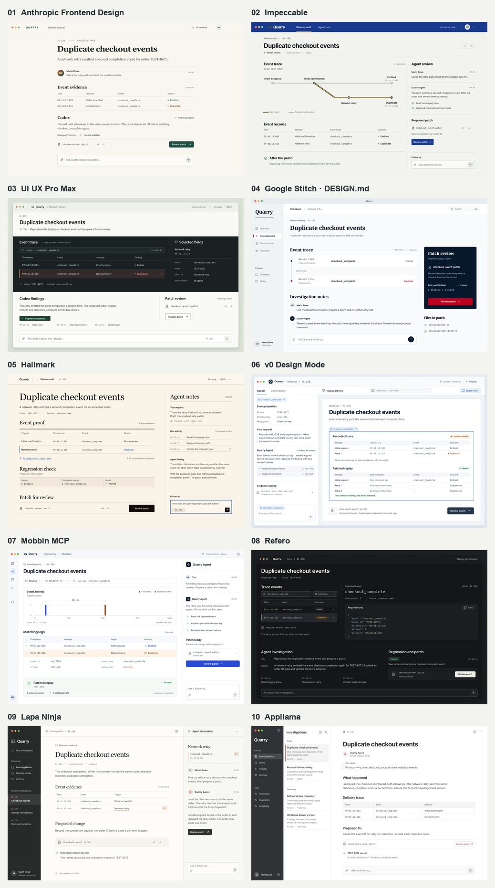

# 用真实界面参考制作 Mac Agent 设计稿

我们用 10 个来源设计了同一个 Mac Agent 工作台, 用户要查明一笔结算为什么发出两次事件, 看懂 Agent 的证据, 决定是否审阅补丁, 本仓库记录从选图, 定规范, 绘制 Figma 到核对导出的实际做法

**Linear 的作用随轮次变化**, 历史 Still 稿直接复制过项目的 Linear 基准, 末轮十稿沿用了基准中的审查任务, 每张从空白画板按各自的来源规范绘制, 其中有多少审美判断受此前看过 Linear 的影响, 现有记录无法给出比例 [Linear 影响的证据与边界](docs/linear-influence.md)

[浏览十稿与对应的 Figma 规范板](cases/index.md) · [复制一份新任务简报](templates/study-brief.md) · [查看完整制作方法](docs/method.md)

[](cases/index.md)

## 制作顺序

| 阶段 | 计划内容 | 交付及验收要求 |
|---|---|---|
| 目标 | 固定任务, 数据, 设备和审阅状态, 给各来源独立决定布局的空间 | 用同一问题检查每份稿, 看用户在哪里找到证据和下一步操作 |
| 选素材 | 从 X, 技能主页, 官方组件, 图库和作者实录找到候选, 追到具体界面 | 每张记下出处, 界面状态和采用的局部, 标明官方生成样本, 第三方实测或独立产品参照 |
| 定规范 | 将参考转成可执行的决定, 为每个取值记录来源和选择理由 | 每个来源一份规范, 分开写原图观察, 本稿取值和例外, 列出对应的负面提示 |
| 画界面 | 在 Figma 放入素材与规范板, 再按该来源的规范绘制原生界面 | 任务, 证据, Agent 回复, 验证结果, 人工审阅和追问入口齐全, 控件与文字可编辑 |
| 验收 | 读回原生节点, 导出 1× PNG, 同时检查整屏和局部 | 核对换行, 遮挡, 对比度, 按钮内容居中和状态含义, 修正源文件后重发并重新导出 |

## 一个例子

Mobbin 收录的 Sentry 日志先给出事件分布, 展开一条记录时在行内显示字段, 我们借用这两处结构, 把原产品的时间窗口换成适合这次调查的 1 秒, 在 83 ms 和 516 ms 各画一次发送, 两者相隔 433 ms, 选中第二条时在它下面显示订单和重试字段, Sentry 提供了布局依据, 1 秒窗口和 376 px 的 Agent 侧栏是本稿决定的尺寸 [参考与规范](cases/mobbin/case.json) · [实际导出](cases/mobbin/design.png) · [绘图源](drawings/mobbin.js)

## 仓库里可以复核什么

- [十份案例记录](cases/index.md)保存 66 项素材记录, 51 张参考图的出处及对应规范板, 110 条按来源统计的规则, 52 条负面提示, 每例附原尺寸成稿和测量记录
- [绘图源](drawings/)保存实际使用的十个 Figma 绘图函数与共用图元, 可对照取值和布局逻辑, 运行环境是加载了对应字体的 Figma 插件上下文
- [Linear 影响分析](docs/linear-influence.md)区分了外部参考, 本项目的改编稿与后续来源稿, 附 11 张画板的原生测量和历史改版记录
- [参考图对照实验](docs/linear-ablation.md)给出尚待执行的匿名评审办法, 单独记录"更愿意使用哪张"和"哪张接近基准"

在仓库根目录用 Python 3 运行以下命令, 可以离线核对案例索引, 引用, PNG 尺寸与 SHA-256 及归档的测量摘要

```sh
python3 tools/verify.py
```

最终 Figma 导出覆盖 570 个可见文本图层, 采样所得最低文字对比度为 4.653:1, 这些检查描述本轮静态画面的执行质量, 用户的偏好需要通过选稿或盲评记录 [验收口径](docs/method.md#验收口径)
