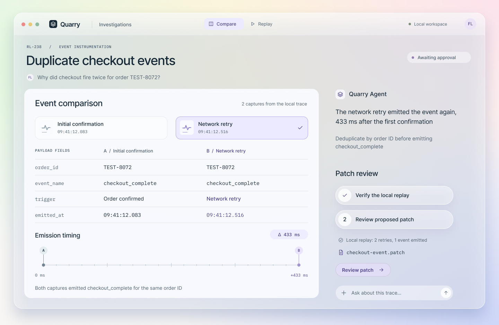

# 和 Agent 一起画界面

假设一个订单被记了两次, 你打开一张图, 能找到这两条记录, 看懂 Agent 改了什么, 也知道还有哪个按钮等你按, 这就是我们想画的界面

**第一次用, 先看两张图**

| 先看底稿 | 再看它怎样变 |
|---|---|
|  |  |
| 左边选一个问题, 点开就能找到证据和下一步 [看底稿](foundations/linear.md) | 右图把两条记录摆在一起, 借了 Still 的选中行和步骤按钮 [看五种画法](cases/index.md) |

**元设计**是画新界面时用的底稿, 目前只有一套, 就是上面左边的 Quarry

**参考图**可以只借一处, 比如学它怎样画一个按钮, 或怎样标出被选中的那一行

| 你现在想做什么 | 打开哪里 |
|---|---|
| 从底稿开始, 分清要保留什么、哪里可以变 | [看 Linear 原图和 Quarry 底稿](foundations/linear.md) |
| 找一个按钮、一行列表或一块玻璃的样子 | [挑参考图, 学怎么找原图](references/README.md) |
| 把喜欢的细节放进新图, 发现不合适时改小样 | [做小样、解决冲突、检查成稿](docs/method.md) |
| 让 Agent 开始画 | [复制设计简报](templates/study-brief.md) |

**可以直接给 Agent 一句话**

> 请按这个仓库的简报设计一个 Mac 界面, 我想用它来 [填入任务], 用 Linear 底稿安排内容, 从参考库选适合这个任务的细节, 先做一个原尺寸的小样, 再交付整张设计稿和检查后的预览图

想看以前做过什么, 可以打开[五份 Still 方案和十个来源案例](cases/index.md), 关于 Linear 对成稿的影响, 另有[测量记录](docs/linear-influence.md)
