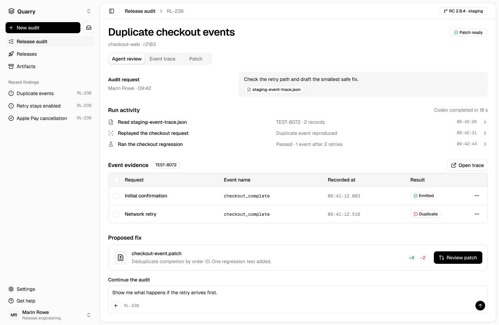

# 和 Agent 一起画界面

## 制作要求

[从这里开始设计](SKILL.md), 点图看原尺寸, 点图下方的链接看该稿从参考到成稿的过程

| Linear | shadcn/ui | Untitled UI | Apple Liquid Glass |
|---|---|---|---|
|  |  |  |  |
| [看制作过程](examples/linear/README.md) | [看制作过程](examples/shadcn-ui/README.md) | [看制作过程](examples/untitled-ui/README.md) | [看制作过程](examples/apple-glass/README.md) |

[历史首稿与案例](cases/index.md) · [研究原件与测量](references/README.md)
