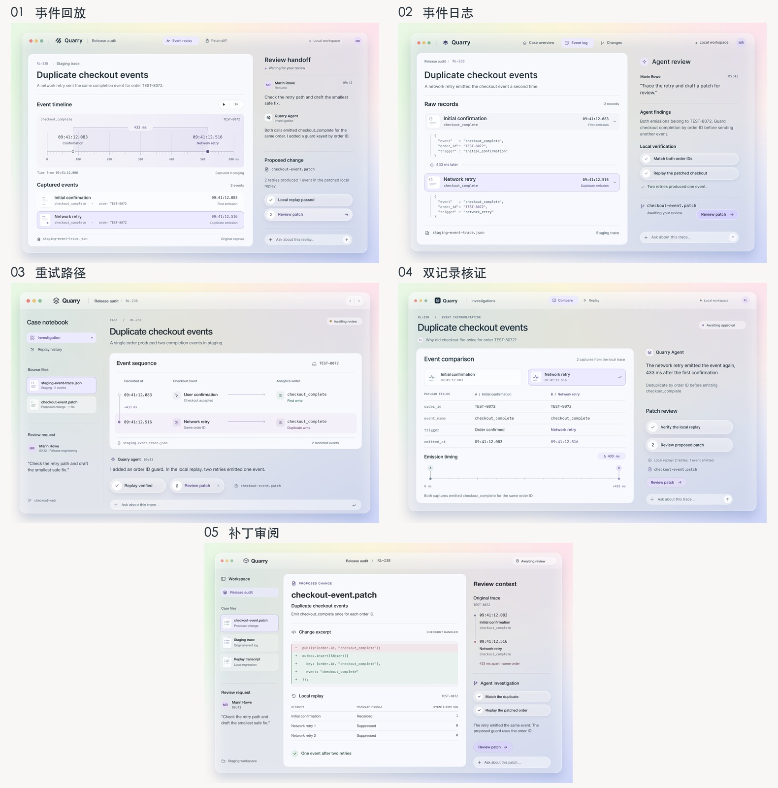

# 用真实界面参考制作 Mac Agent 设计稿

Quarry 是一套供人审阅 Agent 调查结果的 Mac 界面, 各稿围绕同一个问题展开, 一笔订单为何触发两次结算事件, 用户需要哪些证据才能决定是否审阅补丁

保留的五个方案共用这项任务和用户选定的 Still 组件, 各自从空白画板设计, 事件回放用时间线标出两次发送相隔 433 ms, 双记录核证按字段对齐同一订单的两条记录, 补丁审阅把修改内容和本地回放放在一起, 可以在相同数据和审批状态下比较五种布局

| 你想做什么 | 从这里开始 |
|---|---|
| 看五份设计稿、各自的规范, 或对照早期十个来源 | [设计案例](cases/index.md) |
| 了解之前几轮为何被撤下, 哪些做法可以复用 | [制作方法与复盘](docs/method.md) |
| 给设计者或 Agent 布置下一轮任务 | [可复制的简报](templates/study-brief.md) |
| 查 Linear 在各轮影响了什么, 哪些问题仍需对照实验 | [Linear 的影响与证据](docs/linear-influence.md) |

十来源案例另附绘图源、原尺寸 PNG 和测量记录, 可在仓库根目录运行 `python3 tools/verify.py` 离线校验该组归档
