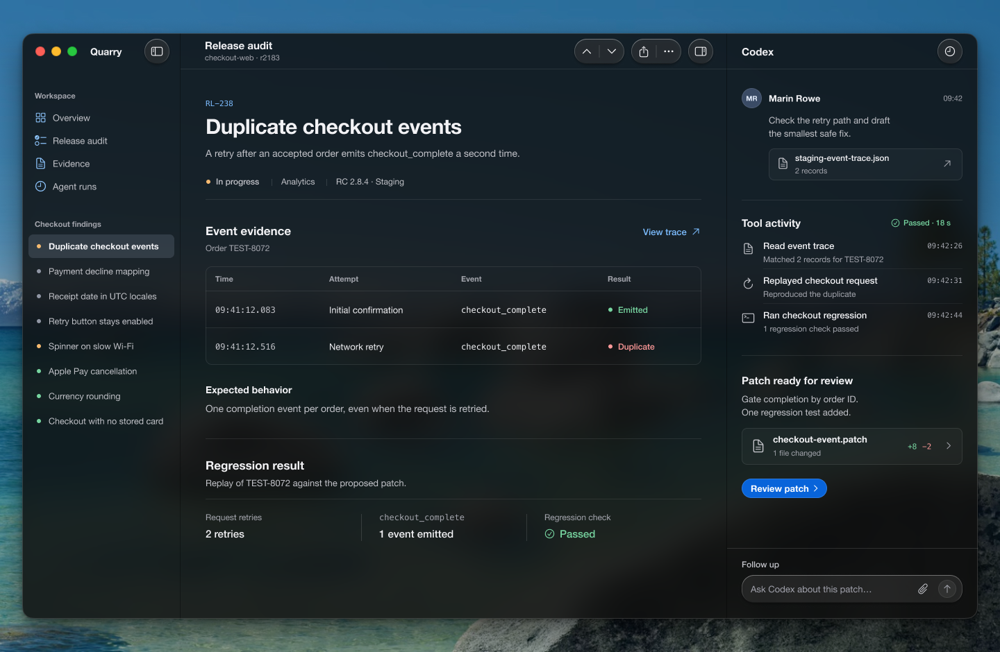
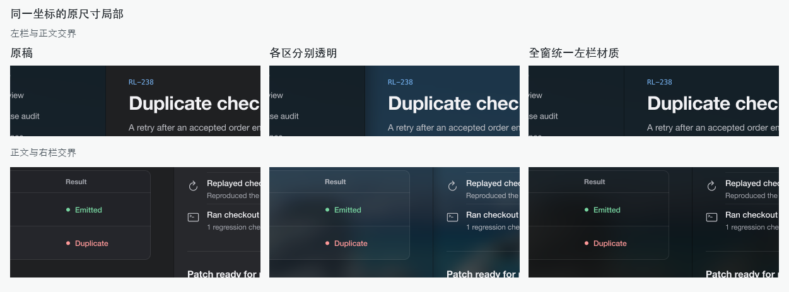

# Apple Liquid Glass · 全窗统一左栏材质

这是用户目前最喜欢的稿, 先看湖面的蓝色怎样从左栏延伸到正文和右栏, 再看白色标题、两行事件记录和蓝色审阅按钮, 正文能顺着表格阅读, 按钮仍位于右侧补丁下方

## 三版的区别

三稿中是同一笔订单和同一个操作, 可以只看背景怎样变, 三张都是 1440 × 940 的实际导出, 下图截取同一坐标的两处交界

| 画到哪一步 | 实际做法 | 看原图 |
|---|---|---|
| 原稿 | 壁纸颜色进入左栏, 中央正文和右侧检查器各有深色实底, 顶部工具组另有小块玻璃 | [原稿 PNG](../references/apple-liquid-glass.png) · [可编辑稿](https://www.figma.com/design/scYOkdhE2byoPHW4Gk1aDL/Untitled?node-id=51-23751) |
| 各区分别透明 | 顶栏、正文、右栏分别做玻璃, 三处底色的不透明度依次为 57%、68%、61%, 各区单独取背景色 | [分区透明 PNG](../references/apple-process/full.png) · [可编辑稿](https://www.figma.com/design/scYOkdhE2byoPHW4Gk1aDL/Untitled?node-id=74-37804) |
| 全窗统一左栏材质 | 重新从原稿复制, 把左栏内的一张壁纸和一块玻璃移到整个窗口底部, 三栏与顶栏共同透出这一层 | [统一材质 PNG](../references/apple-process/uniform.png) · [可编辑稿](https://www.figma.com/design/scYOkdhE2byoPHW4Gk1aDL/Untitled?node-id=75-38790) |

Apple 的设计指南把 Liquid Glass 用于导航与控件, 为正文背景推荐标准材质, 全窗都铺侧栏材质是本项目的对照实验, 用户在三张图里选中了这一张 [Apple 材质指南](https://developer.apple.com/design/human-interface-guidelines/materials#Liquid-Glass) · [Apple 的 AppKit 演示](https://developer.apple.com/videos/play/wwdc2025/310/)

## 在 Figma 里怎样做

1. **定窗口和内容**, 画板上留出桌面, 窗口左 32、上 48, 宽 1376、高 844, 圆角 16 px, 左栏放问题列表, 中间放两条事件, 右栏放 Agent 的解释和待审补丁 [窗口及内容](https://www.figma.com/design/scYOkdhE2byoPHW4Gk1aDL/Untitled?node-id=75-38794)
2. **对齐窗口内外的湖面**, 复制原稿, 把左栏里的 Tahoe Day 壁纸移到窗口图层最底下, 源图为 1600 × 899 px, 保留壁纸图层的 1440 × 940 px 尺寸和填充模式, 窗内位置为 x = −32, y = −48, 图像模糊 32 px, 用窗口圆角裁切 [壁纸源图](../references/apple-process/tahoe-day.jpg) · [壁纸层](https://www.figma.com/design/scYOkdhE2byoPHW4Gk1aDL/Untitled?node-id=75-38796)
3. **让整窗共用一块玻璃**, 把原来宽 228 px 的左栏材质移到壁纸上方, 扩成 1376 × 844, 沿用深灰填充、不透明度和原来的折射参数, 窗口本身保留深色实底, 这里看到的是 Figma 内对齐壁纸后的静态效果 [全窗玻璃层](https://www.figma.com/design/scYOkdhE2byoPHW4Gk1aDL/Untitled?node-id=75-38797)
4. **露出被盖住的部分**, 清空正文、事件表、右栏和右下追问区的填充, 移除挡在顶栏工具后面的实色底板, 保留表格边界、侧栏选中行及控件本身的轮廓 [事件表](https://www.figma.com/design/scYOkdhE2byoPHW4Gk1aDL/Untitled?node-id=75-38877) · [追问区](https://www.figma.com/design/scYOkdhE2byoPHW4Gk1aDL/Untitled?node-id=75-38976)
5. **把能点的东西放在玻璃上面**, 选中行加字重和底色, 上一项与下一项共用小工具底板, 检查通过显示绿色勾和文字, 补丁仍需人按蓝色的 Review patch 审阅 [选中问题](https://www.figma.com/design/scYOkdhE2byoPHW4Gk1aDL/Untitled?node-id=75-38836) · [补丁按钮](https://www.figma.com/design/scYOkdhE2byoPHW4Gk1aDL/Untitled?node-id=75-38975)

打开原尺寸组件和材质参数

| 在哪里 | 这张稿的取值 | 检查哪一处 |
|---|---|---|
| 全窗材质 | 填充 #0C0C0C, 不透明度约 85%, Figma Glass 折射 0.30、深度 12、磨砂半径 36、高光强度 0.10、光向 −60°、色散 0 | 窗口里是一张已模糊的壁纸加一块玻璃, 文字在两者之上 |
| 工具组与追问输入 | 填充 #999999, 不透明度约 17%, 折射 0.46、深度 8、磨砂半径 4、高光强度 0.22, 光向与色散同上 | 全窗有 1 块底部玻璃, 另有 6 块工具或输入控件玻璃 |
| 主要分区 | 左栏宽 228 px, 中间 786 px, 右栏 362 px, 顶栏高 52 px | 时间和事件按列读, 准备好补丁与等待人审阅有不同位置 |
| 可点的原尺寸样件 | 选中行高 34 px, 双按钮工具组 72 × 36 px, 主操作高 28 px | 比较选中与普通行的字重和轮廓, 检查图标与工具底板对齐 |

侧栏深色填充参考了 Apple 设计套件, 本机 AppKit 布局树量到工具栏高 52 pt、双项工具底板 70 × 36 pt, 本稿在 Figma 中采用 52 px 和 72 × 36 px, 折射和磨砂是经 Figma 导出试验后采用的值 [三版图层读数](../references/apple-process/materials.json) · [本机尺寸记录](../references/apple-process/native-geometry.txt) · [原尺寸组件](https://www.figma.com/design/scYOkdhE2byoPHW4Gk1aDL/Untitled?node-id=52-25041) · [设计依据](https://www.figma.com/design/scYOkdhE2byoPHW4Gk1aDL/Untitled?node-id=52-25066)

## 旁边的研究板怎样用

这张 1440 × 8112 的研究板记录了 Apple 原稿的制作过程, 全窗版是在原稿上另外做的对照, 原板有 13 项素材、42 条研究依据和 50 条本稿定义, 可以按问题直接跳到一节, 也可以搜索某个控件或材质 [92 条可搜索的原板笔记](../references/apple-process/study-notes.md) · [完整研究板 PNG](../references/apple-process/board.png) · [原生研究板](https://www.figma.com/design/scYOkdhE2byoPHW4Gk1aDL/Untitled?node-id=52-24248)

| 想解决的问题 | 在板上看什么 |
|---|---|
| 真实的 Mac 界面怎样分层 | Apple Music 侧栏随背后的封面取色, Notes 把工具放在顶部胶囊里, iA Writer 与 Things 提供文档、选中行和弹层的对照 [参考实物](https://www.figma.com/design/scYOkdhE2byoPHW4Gk1aDL/Untitled?node-id=52-24945) |
| 哪一层给背景着色, 哪一层放文字 | 对照壁纸、侧栏、工具组和阅读区, 先确定每一层要让人看到什么 [本稿的材质与层级](https://www.figma.com/design/scYOkdhE2byoPHW4Gk1aDL/Untitled?node-id=52-25001) |
| 从原件到成稿, 什么有实测可查 | 看 1× 工具组、选中行和审阅按钮, 再对照官方素材、本机测量和玻璃实验, 从取值追到使用部位 [原尺寸组件](https://www.figma.com/design/scYOkdhE2byoPHW4Gk1aDL/Untitled?node-id=52-25041) · [研究依据](https://www.figma.com/design/scYOkdhE2byoPHW4Gk1aDL/Untitled?node-id=52-25066) |
| 下次哪些决定可以重新做 | 把旁边作品的做法与本稿选择分开, 例如正文放在哪里、什么用蓝色、哪些边界需要保留 [本稿定义](https://www.figma.com/design/scYOkdhE2byoPHW4Gk1aDL/Untitled?node-id=52-25223) · [补充来源](https://www.figma.com/design/scYOkdhE2byoPHW4Gk1aDL/Untitled?node-id=52-25404) |

## 导出后怎么查

- **查连续性**, 在 1× PNG 左上角起算, 取左栏与正文相邻的两处空白 (240, 180) 和 (275, 180), 分区透明稿读到 RGB(21, 33, 40) 与 RGB(28, 51, 69), 统一稿两处都是 RGB(21, 33, 40), 再看整张湖景的颜色是否随位置自然改变 [三个版本的同位置局部](../references/apple-process/layer-detail.png)
- **查内容**, 回读原稿和统一稿的 75 个文字图层, 文案、字框位置与尺寸、字体及填充逐项相同, 导出图上可以读到两次发送、一次回放结果和待审操作
- **查玻璃是否产生折射**, 制作时把红绿标线放在六种测试材料下, 背景模糊会使线变宽, 高折射测试在 1428 个可测截面中有 398 处偏移至少 2 px, 这组高折射值用于识别效果, 成稿另用上表的参数 [六组对照图](../references/apple-process/proof.png) · [逐组测量数据](../references/apple-process/refraction-results.json) · [Figma 效果说明](https://help.figma.com/hc/en-us/articles/360041488473-Apply-effects-to-layers)

换成自己的设计时, 先放一张真实背景、一段真实正文和一个可点工具, 让它们在同一小块里出现, 按原尺寸看文字和边缘, 再决定材质要铺多大
