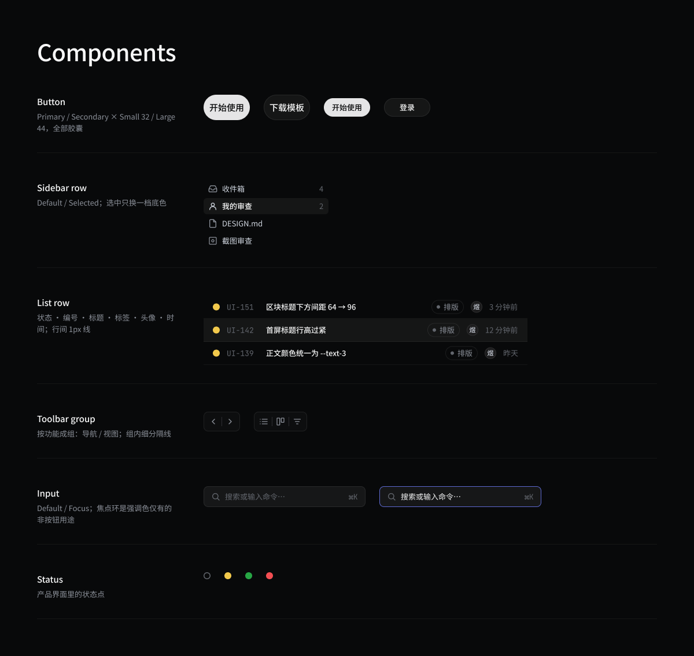
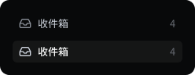
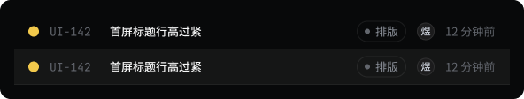
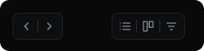
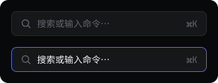

# Linear 原稿的组件

下图是原稿的组件总览, 同一组控件可以对照默认、选中、聚焦等状态, 点图可按 1200 × 1136 px 查看

## 从侧栏选中一条问题

在侧栏选中「收件箱」后, 216 × 28 px 的行保留图标、名称和计数的位置, 下方第二行展示选中底色, 问题列表使用 560 × 40 px 行, 状态、编号、标题、标签、头像和时间可以沿列扫描, 同一条 UI-142 在普通和选中两态都保留这些字段

状态组从左到右是待办、进行中、完成、阻塞, 每个标记占 12 × 12 px, 标签和头像在上方列表中都有暗底上的实际用例

| 单个组件 | 组件原图 | 用于识别 |
|---|---|---|
| Tag, 56 × 24 px |  | 问题分类, 此处用「排版」和圆点 |
| Avatar, 20 × 20 px |  | 负责人, 此处用 11 px 的「煜」 |

## 选择操作, 切换视图, 搜索

按钮的上排是主按钮, 下排是次按钮, 左列高 32 px、字号 13 px, 右列高 44 px、字号 15 px

16 × 16 px 图标放在 28 × 28 px 的工具按钮中, 左边的两项组用于前后导航, 右边的三项组用于视图和筛选

| 单个组件 | 组件原图 |
|---|---|
| Toolbar/Icon button, 28 × 28 px, 查看图标在按钮内的留白 |  |

输入框的两态均为 280 × 36 px, 获得焦点时边线变为靛蓝, 占位文字和右侧快捷键保留在原位

## 图标

每个图标为 16 × 16 px, 从左到右依次是收件箱、用户、文件、图层、相机、闪电、搜索、筛选、列表、看板、更多、添加、上、下、左、右、菜单、向上箭头

## 原稿节点和本地图片

Components 页 `2:166` 有 11 项一级内容, 含一张总览、一张图标板、六个组件集和三个单独的主组件, 下表中图片均按 1× 导出, 尺寸单位为 px, 子节点的顺序与上文各图排列一致, 按钮按行从左到右读 [原文件 Components 页](https://www.figma.com/design/cytw6jxvr7NDe0K406hGME?node-id=2-166)

| 一级节点 | PNG 和尺寸 | 子节点 |
|---|---|---|
| `6:52` Components / Overview | [总览, 1200 × 1136](../../../foundations/original/components.png) | 按钮 `6:54`, 侧栏 `6:67`, 列表 `6:113`, 工具组 `6:152`, 输入框 `6:190`, 状态 `6:209` |
| `3:2` Icons | [图标板, 608 × 64](icons.png) | 18 个图标按上图顺序为 `3:3`, `3:7`, `3:11`, `3:15`, `3:20`, `3:24`, `3:27`, `3:31`, `3:36`, `3:44`, `3:48`, `3:53`, `3:57`, `3:60`, `3:63`, `3:66`, `3:69`, `3:73` |
| `3:85` Status | [四种状态, 128 × 44](status.png) | `3:77`, `3:79`, `3:81`, `3:83` |
| `3:86` Avatar | [文字头像, 20 × 20](avatar.png) | 文字 `3:87` |
| `3:88` Tag | [标签, 56 × 24](tag.png) | 圆点 `3:89`, 文字 `3:90` |
| `4:10` Button | [主次按钮, 312 × 160](buttons.png) | `4:2`, `4:4`, `4:6`, `4:8` |
| `4:25` Sidebar row | [侧栏两态, 248 × 96](sidebar-rows.png) | `4:11`, `4:18` |
| `4:48` List row | [问题行两态, 592 × 112](list-rows.png) | `4:26`, `4:37` |
| `4:49` Toolbar/Icon button | [独立工具按钮, 28 × 28](icon-button.png) | 图标实例 `4:50` |
| `4:119` Toolbar group | [两项与三项组, 256 × 64](toolbar-groups.png) | `4:58`, `4:82` |
| `4:134` Input | [输入框两态, 312 × 120](inputs.png) | `4:120`, `4:127` |
