# shadcn/ui · 调查一次重复结算

订单 `TEST-8072` 在 433 ms 内产生两次结算事件, 审阅者沿一页读完请求、运行记录、事件证据和补丁, 在两行事件之间核对时间和结果, 再从补丁旁的黑色 `Review patch` 进入审阅

[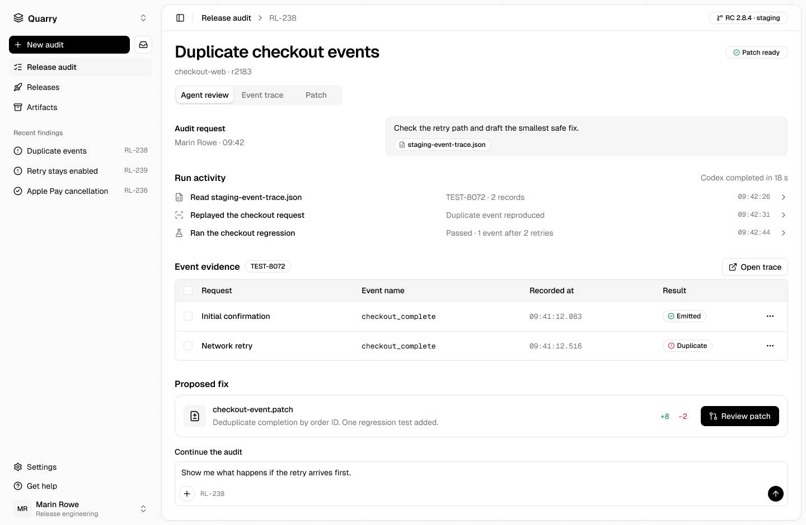](../../references/shadcn-ui.png)

终稿为 1440 × 940 px, 制作时沿用了 Linear 稿的样例订单与调查任务, 将正文留给同一个问题的完整调查 [任务基准原图](../../evidence/linear.png)

## 从官网实物确定布局和控件

研究使用 Dashboard 01 的 New York v4 浅色主题, 桌面视口为 1440 × 1000 px, 窄窗为 740 × 820 px, 下列 6 张图保留官网控件的原始像素 [浏览器实测与采用范围](../../references/library-process/shadcn/measurements.md)

**展开的侧栏和顶栏**, 侧栏宽 288 px, 普通菜单行高 32 px, 图标宽 16 px, 图文间距 8 px, 稿中沿用这组尺寸放置工作区和问题导航, 顶栏实图还能核对 48 px 栏高与指标卡上的描边标签

| 侧栏 | 顶栏与指标卡 |
|---|---|
| [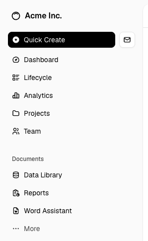](../../references/originals/shadcn-sidebar.png) | [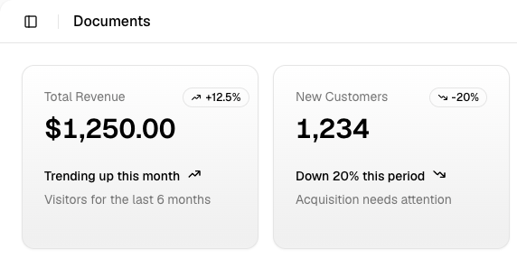](../../references/library-process/shadcn/02-header-card.png) |

**视图切换和数据行**, 滚动到 Outline 后, 上方标签组高 36 px, 下方表头高 40 px、数据行高 53 px, 稿中把首次确认和网络重试放在同一组列下, 两行共享分隔线

[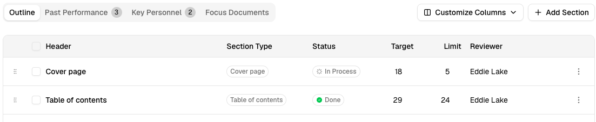](../../references/library-process/shadcn/03-table.png)

**桌面详情、输入焦点和窄窗导航**, 在桌面点开 Cover page, 右侧出现 384 px 宽的抽屉, 用键盘聚焦 Header 后, 可见输入框外侧 3 px 焦点环, 在窄窗点导航开关可见左侧 288 px 宽的浮层, Quarry 桌面稿在正文显示当前调查, 追问框允许多行输入, 高 80 px

| 桌面详情 | 输入框取得焦点 | 窄窗导航展开 |
|---|---|---|
| [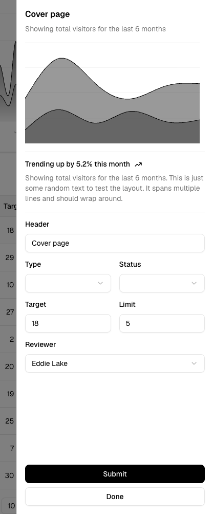](../../references/library-process/shadcn/04-drawer.png) | [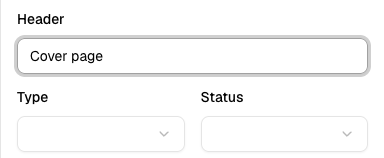](../../references/library-process/shadcn/05-input.png) | [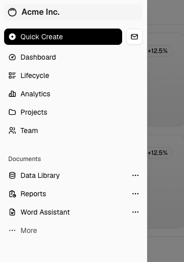](../../references/library-process/shadcn/06-sheet.png) |

## 首稿和修改

首稿导出于 2026-11-20 00:54 (北京时间), 288 px 导航右侧留有 1096 px 正文, 用户请求带附件, 下接 3 条运行记录, 再用事件表并列核对两个时间戳, 人工审阅的入口放在 `checkout-event.patch` 这一行

[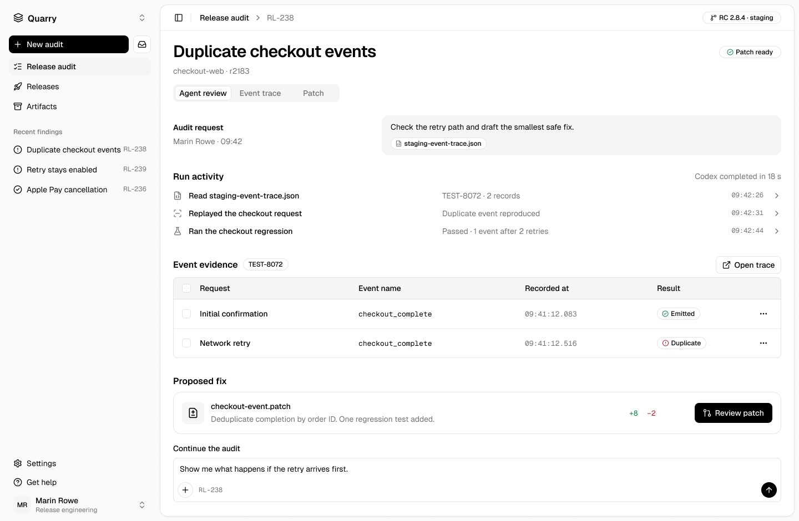](../../references/library-process/shadcn/first-screen.png)

首稿的标签组高 32 px, 对照官网表格后调为 36 px, 下方两张图取自首稿和终稿的同一位置, 可观察选中标签的高度与留白

| 首稿 · 32 px | 终稿 · 36 px |
|---|---|
| [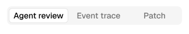](revision-first.png) |  |

## 完整规范板与原尺寸分段

[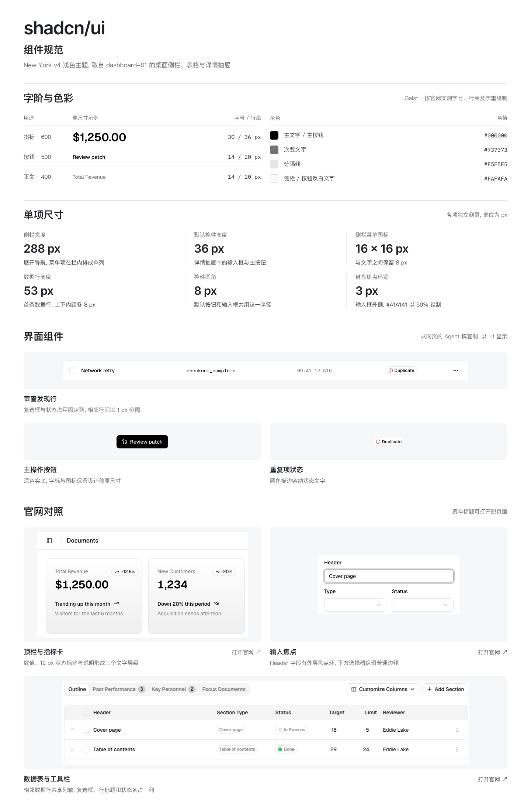](../../references/library-process/shadcn/board.png)

下列 5 张图依次覆盖原板全部 2193 行像素, 每张宽 1440 px, 点图可打开原尺寸

**字阶与色彩 · 第 1–542 行**, Geist 的指标、按钮、正文分别采用 600、500、400 字重, 右侧色表对应主文字、次文字、分隔线和侧栏

[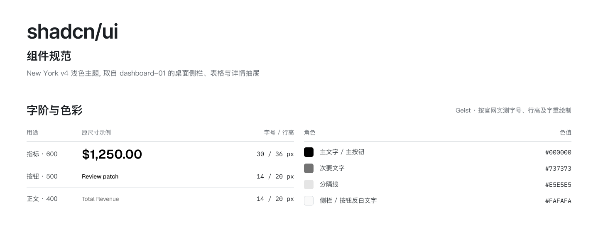](spec-01.png)

**单项尺寸 · 第 543–871 行**, 对照侧栏、控件、图标、数据行、圆角和焦点环的 6 项测量

[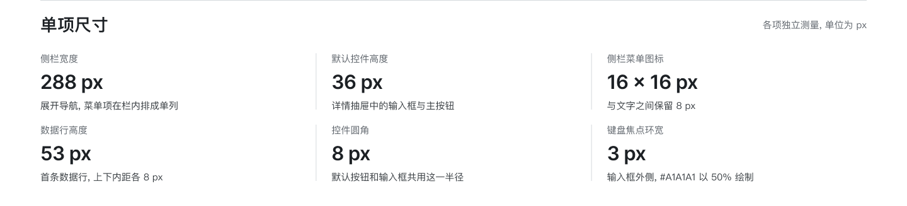](spec-02.png)

**界面组件 · 第 872–1345 行**, 第一行是重试事件, 下方是审阅按钮和重复状态, 两行事件中的请求、事件名和时间戳均按行内 x=48、334、634 px 排列

[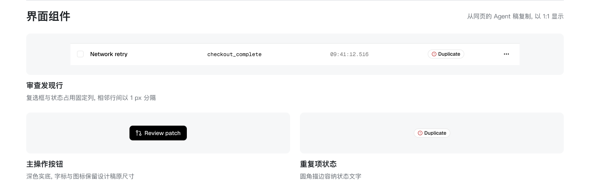](spec-03.png)

**官网对照 · 第 1346–1820 行**, 并排观察指标卡的文字层级和输入框取得焦点后的边界

[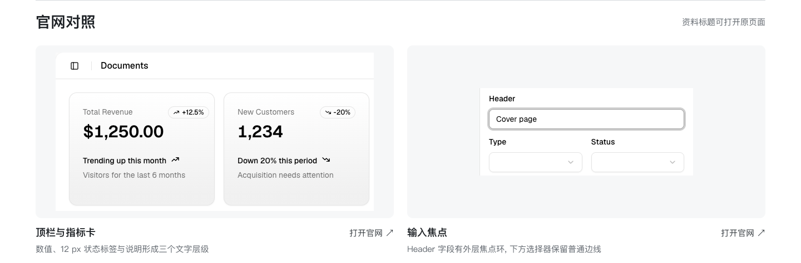](spec-04.png)

**官网对照 · 第 1821–2193 行**, 查看标签、复选框、记录名和状态分别占据的列

[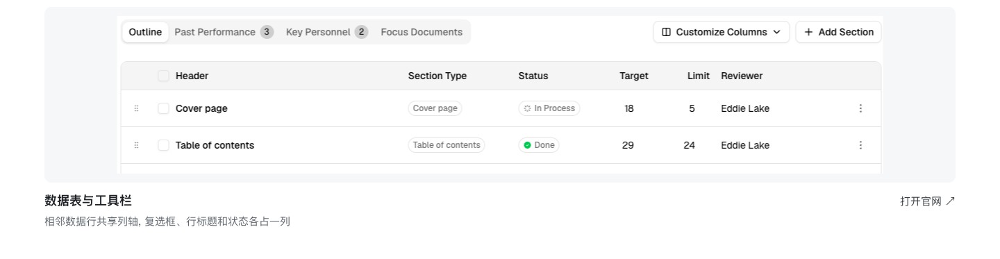](spec-05.png)

## 画板和核验记录

项目页 `47:20649` 有两份组件库成稿及各自的规范板, 本例的成稿和规范板各占一个顶层画板, 归档时两个画板的 Figma 1× PNG 均与上方整图逐字节一致

| 画板或节点 | 对应的本地图像 |
|---|---|
| 成稿 `47:20650`, 导航 `50:22847`, 内嵌工作区 `50:22926` | [终稿整屏](../../references/shadcn-ui.png) · [同画板首稿](../../references/library-process/shadcn/first-screen.png) |
| 视图标签组 `50:22952` | [修改前](revision-first.png) · [终稿中的标签](revision-final.png) |
| 规范板 `47:20892`, 字阶 `50:23095`, 色表 `50:23096` | [规范整板](../../references/library-process/shadcn/board.png) · [原尺寸字阶与颜色](spec-01.png) |
| 数据行样件 `50:23155`, 审阅按钮主组件 `50:23222` → 成稿实例 `50:23223`, 重复标签主组件 `50:23236` → 成稿实例 `50:23237` | [规范板样件](spec-03.png) · [成稿中的事件表和补丁行](../../references/shadcn-ui.png) |
| 官网对照的指标卡 `50:23197`, 焦点 `50:23203`, 表格 `50:23209` | [前两项](spec-04.png) · [表格](spec-05.png) |

交付时检查了 30 项组件尺寸与布局、8 处图标位置, 审补丁按钮的图标和文字作为整体, 水平和垂直居中偏差均为 0 px, 图文间距为 6 px [组件核验记录与整图摘要](../../references/library-process/checks.json) · [首稿时间和制作记录](../../references/component-studies.md)

[返回示例首页](../../README.md)
