# Untitled UI · 在问题列表中审阅一项

发布审查里有 8 个问题, 当前选中 `RL-238`, 列表保留其余 7 项的状态, 右侧展开这一项的请求、附件、检查和补丁, 用户可以对照调查结果, 再点紫色 `Review patch` 审阅补丁

[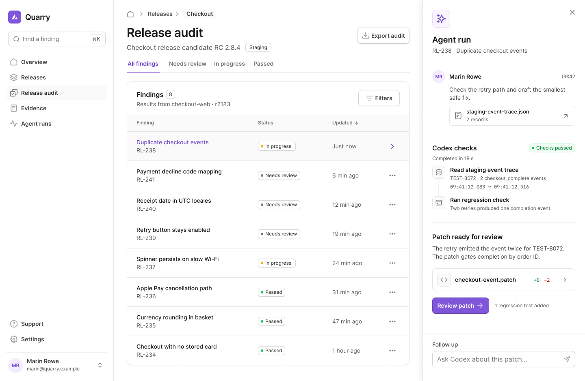](../../references/untitled-ui.png)

终稿为 1440 × 940 px, 沿用 Linear 稿的发布审查任务和订单 `TEST-8072`, 横向空间分给 280 px 导航、760 px 工作区和 400 px 详情 [任务基准原图](../../evidence/linear.png)

## 从官网实物确定布局和控件

这次使用 Untitled UI React 的默认浅色主题和品牌紫, 下列 8 张官网截图分别记录侧栏、表格、按钮、徽章、两种输入状态、标签栏和复选框 [逐项尺寸、状态与组件源码出处](../../references/library-process/untitled/measurements.md)

**定位工作区和当前问题**, 官网 Simple 侧栏宽 280 px, 普通导航行高 36 px, Team members 表格的中号表头高 44 px、数据行高 72 px, 稿中用这组行高显示 8 个问题, 将 SlideoutMenu 里的标题、内容和底部输入安排到常驻的右栏, 用户查看详情时仍能读到整批记录

[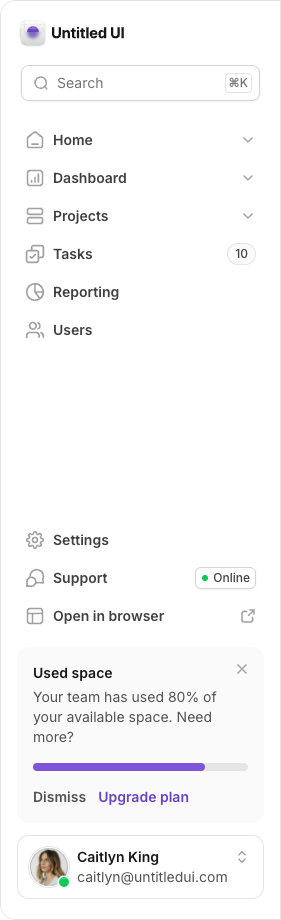](../../references/library-process/untitled/sidebar.png)

[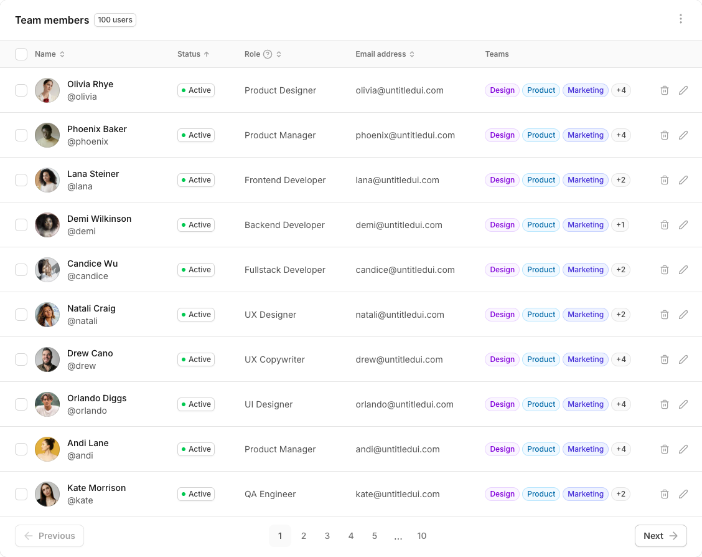](../../references/library-process/untitled/table.png)

**区分动作和检查结果**, 官网中号按钮高 40 px, 图标宽 20 px, 图文间距 4 px, 稿中用白底按钮导出整次审查、紫底按钮审阅当前补丁, 表内状态沿用 Team members 表格的白底带点标签, 右侧的检查结果采用绿色圆点和浅绿底

[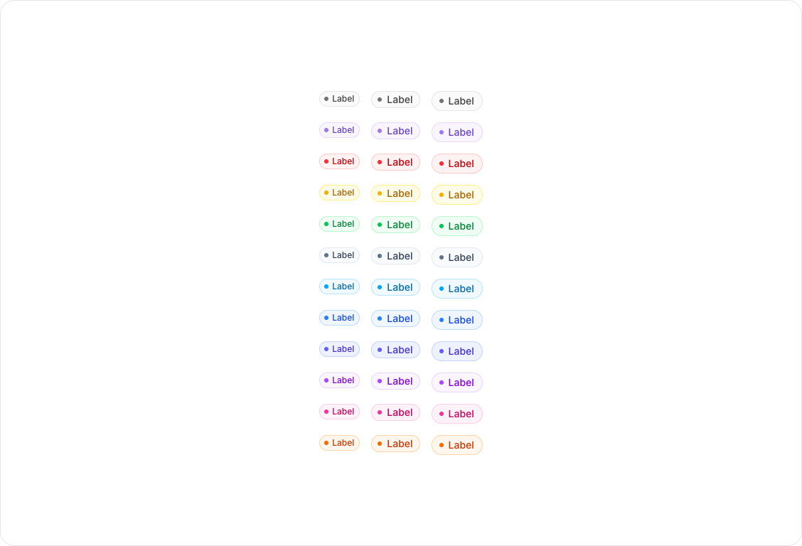](../../references/library-process/untitled/badges.png)

**输入状态**, 官网中号输入框高 40 px, 标签到输入框、输入框到说明各留 6 px, 错误态同时出现错误边线、尾图标和独立提示, 成稿中的右栏追问采用 40 px 输入框, 左侧搜索采用 36 px 输入框

| 正常输入 | 错误输入 |
|---|---|
|  |  |

**筛选和选择**, 小号标签栏高 32 px, 选中标签用 2 px 紫色下划线, 成稿用它区分全部、待审、进行中和已通过的问题, 官网复选框样本记录了选项、标签和说明之间的间距

| 官网标签栏 | 官网复选框 |
|---|---|
|  |  |

## 首稿和修改

首稿导出于 2026-11-20 00:56 (北京时间), 中栏已放入全部 8 项, 所选问题的右栏从请求、附件接到两项检查, 再显示补丁和追问, 整体结构在首次绘图时已经确定

[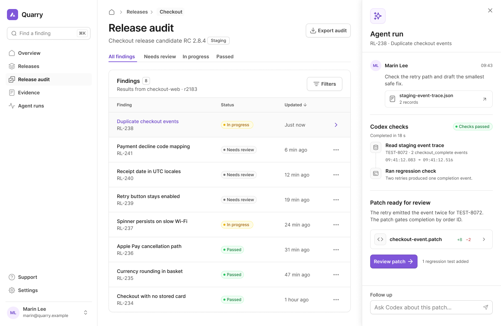](../../references/library-process/untitled/first-screen.png)

首稿的进行中和通过状态使用有色底, 对照官网表格后, 终稿将三种状态统一为白底、灰边、圆角 6 px, 用状态名和直径 6 px 的圆点保留区别, 右栏的 `Checks passed` 单独保留浅绿色底, 下面两张图截自两版相同位置 [首轮审阅时留存的表格局部](../../references/library-process/untitled/table-first-draft.jpg)

| 首稿 · 有色底 | 终稿 · 白底与状态圆点 |
|---|---|
| [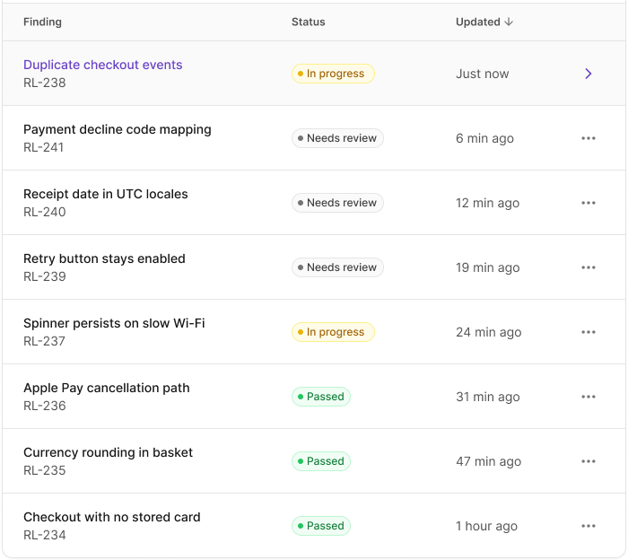](revision-first.png) | [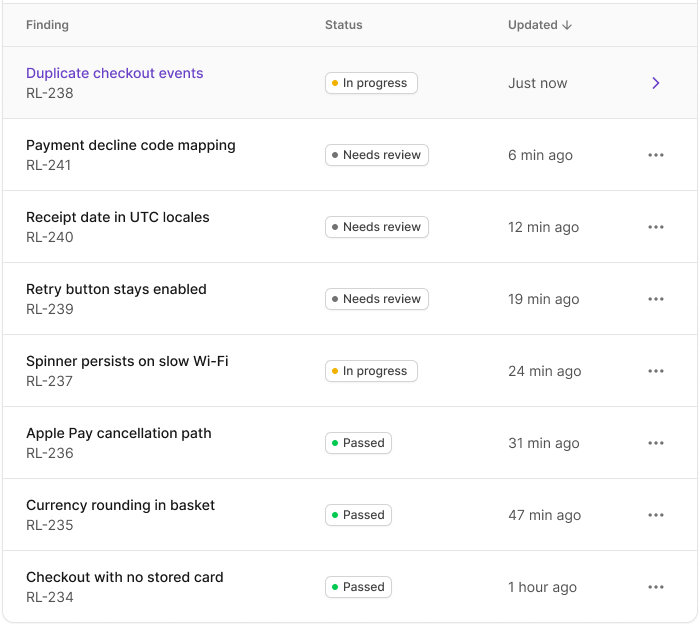](revision-final.png) |

## 完整规范板与原尺寸分段

[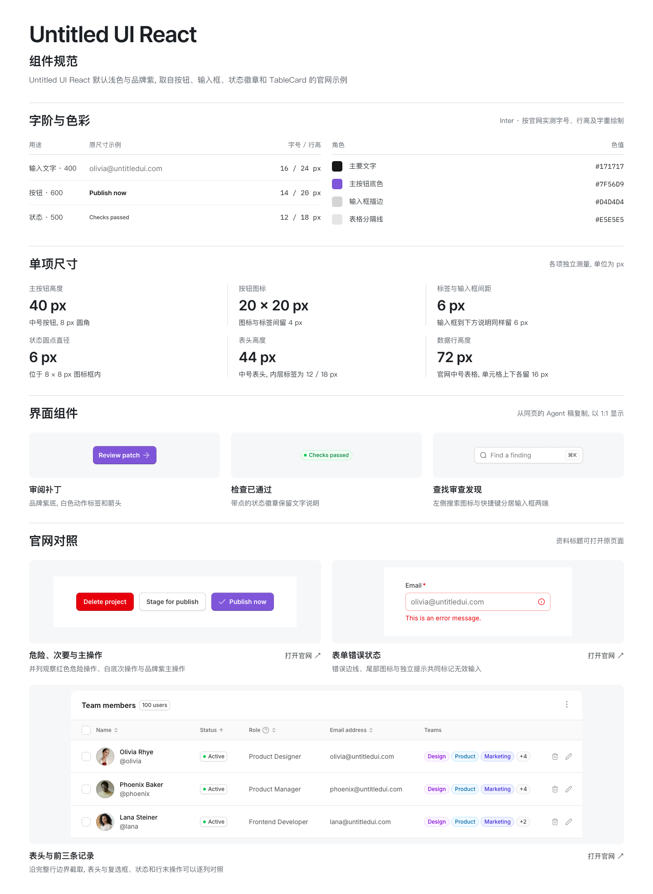](../../references/library-process/untitled/board.png)

下列 5 张图依次覆盖原板全部 1970 行像素, 每张宽 1440 px, 点图可打开原尺寸

**字阶与色彩 · 第 1–542 行**, Inter 的输入文字、按钮和状态标签分别采用 400、600、500 字重, 右侧列出文字、品牌按钮底色和两种边线色

[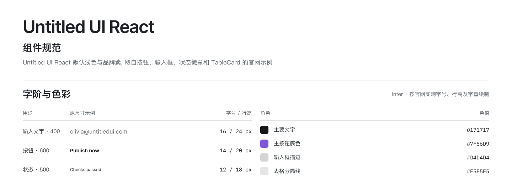](spec-01.png)

**单项尺寸 · 第 543–871 行**, 对照按钮、图标、输入间距、状态圆点、表头和数据行

[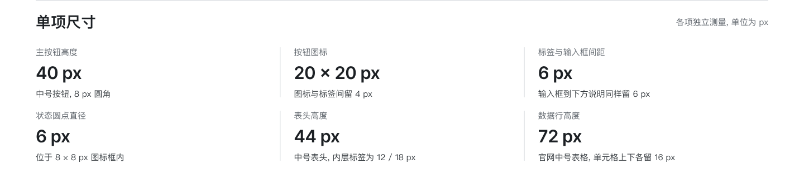](spec-02.png)

**界面组件 · 第 872–1152 行**, 从左到右分别为审阅补丁、检查通过、搜索问题, 可核对圆角、边线、图文间距和快捷键位置

**官网对照 · 第 1153–1498 行**, 查看按钮中危险、次要和主要动作的用色, 以及无效输入的边线、尾图标和说明

[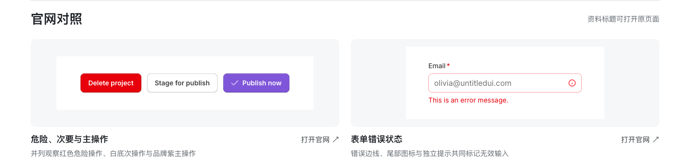](spec-04.png)

**官网对照 · 第 1499–1970 行**, 可沿前三条记录逐列查看复选框、名称、状态与行末操作的位置

## 画板和核验记录

项目页 `47:20649` 有两份组件库成稿及各自的规范板, 本例的成稿和规范板各占一个顶层画板, 归档时两个画板的 Figma 1× PNG 均与上方整图逐字节一致

| 画板或节点 | 对应的本地图像 |
|---|---|
| 成稿 `50:21410`, 导航 `50:22453`, 问题工作区 `50:22501`, 右侧详情 `50:22631` | [终稿整屏](../../references/untitled-ui.png) · [同画板首稿](../../references/library-process/untitled/first-screen.png) |
| 问题表 `50:22527`, 选中行 `50:22544` | [修改前](revision-first.png) · [终稿中的表格](revision-final.png) |
| 规范板 `50:22310`, 字阶 `50:22711`, 色表 `50:22712` | [规范整板](../../references/library-process/untitled/board.png) · [原尺寸字阶与颜色](spec-01.png) |
| 审阅按钮 `50:22820` → `50:22821`, 通过徽章 `50:22829` → `50:22830`, 搜索输入 `50:22839` → `50:22840`, 箭头从主组件指向成稿实例 | [规范板的三个样件](spec-03.png) · [成稿中的实例](../../references/untitled-ui.png) |
| 官网对照的按钮 `50:22797`, 错误输入 `50:22803`, 表格 `50:22809` | [按钮与输入](spec-04.png) · [表格](spec-05.png) |

交付时检查了 46 项组件尺寸与布局、8 处图标位置, 审补丁按钮的图标和文字作为整体, 水平和垂直居中偏差均为 0 px, 图文间距为 4 px [组件核验记录与整图摘要](../../references/library-process/checks.json) · [首稿时间和制作记录](../../references/component-studies.md)

[返回示例首页](../../README.md)
