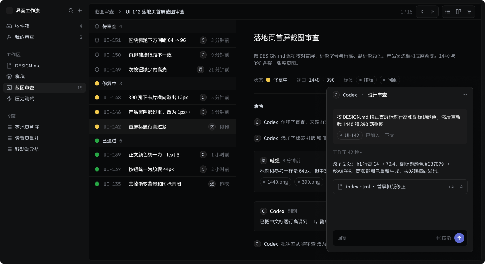
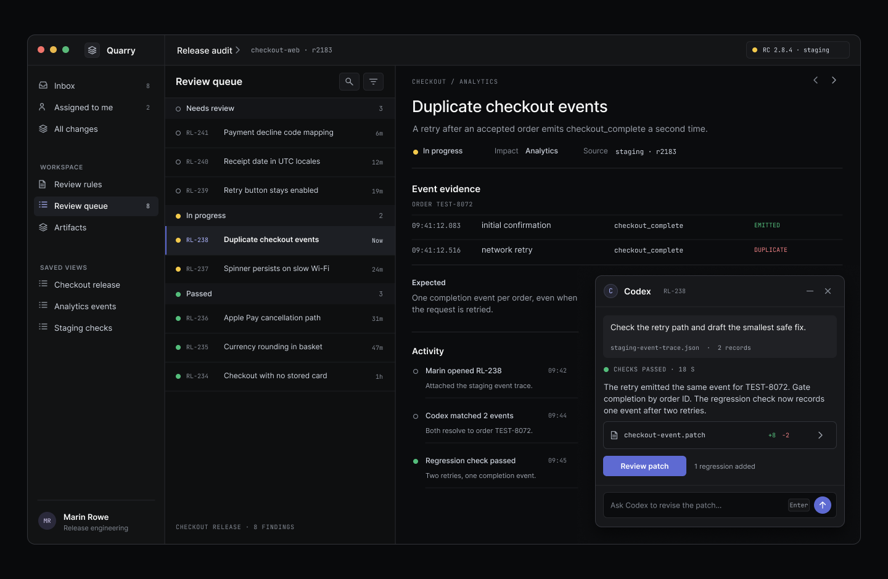

# 从 Linear 底稿开始

先在左边点一个问题, 看旁边的记录和 Agent 的解释, 再决定下一步, 这套顺序既可以审截图, 也可以审订单

| 原稿用它审截图 | Quarry 用它审订单 |
|---|---|
|  |  |

左边是用户给的 Linear 风格 Figma, 右边是这个项目沿用它做的 Quarry, 目前仓库把这一套作为元设计, 下文先读左图的出处, 再看新任务怎样沿用它

## 原稿有三页, 各查一件事

| 页 | 打开它可以看到什么 | 原尺寸图和 Figma |
|---|---|---|
| Foundations · 基础规则 | 颜色、字号、圆角、间距与布局、表面与阴影, 五部分共一张 1440 × 4126 的板 | [整张图](original/foundations.png) · [可编辑原稿](https://www.figma.com/design/cytw6jxvr7NDe0K406hGME?node-id=5-242) |
| Components · 组件 | 1200 × 1136 的总览并排展示按钮、侧栏行、列表行、工具组、输入框和状态点, 同页另有 18 个图标及可点开量尺寸的主组件 | [整张图](original/components.png) · [可编辑总览](https://www.figma.com/design/cytw6jxvr7NDe0K406hGME?node-id=6-52) · [图标](https://www.figma.com/design/cytw6jxvr7NDe0K406hGME?node-id=3-2) |
| Screens · 整页样例 | 同一落地页有桌面和手机两稿, 从首屏的审查窗口往下能看到规范检查、截图审查、压力测试, 桌面 1440 × 7263, 手机 390 × 5771 | [桌面整图](original/desktop.png) · [手机整图](original/mobile.png) · [桌面原稿](https://www.figma.com/design/cytw6jxvr7NDe0K406hGME?node-id=7-2) · [手机原稿](https://www.figma.com/design/cytw6jxvr7NDe0K406hGME?node-id=12-342) |

## 跟着一条真实的选中行读三页

1. **看它怎么标出选中**, 基础页给暗色表面配了一档约 5% 的白色叠层, 先在列表底色上比较普通行和选中行 [表面样本](https://www.figma.com/design/cytw6jxvr7NDe0K406hGME?node-id=5-252)
2. **看这一行装了什么**, 选中列表行的主组件是 560 × 40 px, 左右各留 16 px, 状态点、编号、标题、标签、头像和时间排成一行, 底部有 1 px 分割线, 选中时加浅底 [选中行主组件](https://www.figma.com/design/cytw6jxvr7NDe0K406hGME?node-id=4-37)
3. **看空间少了怎么改**, 桌面的 UI-142 实例宽 399 px, 隐藏标签, 手机版同一实例宽 340 px, 再隐藏头像, 两边均保留状态、编号、标题、时间和 40 px 行高 [桌面实例](https://www.figma.com/design/cytw6jxvr7NDe0K406hGME?node-id=7-303) · [手机实例](https://www.figma.com/design/cytw6jxvr7NDe0K406hGME?node-id=12-452)

做自己的列表时, 先写下用户认出一项任务需要哪些字段, 再定宽度不够时哪些可以收起, 把实际最长的一行放进画板检查

查原稿数值, 或看另一个组件怎么做

| 想画什么 | 原稿里的决定 |
|---|---|
| 文字有主次 | 主文字、次文字、辅助文字、弱提示四级依次为 <code>#F7F8F8</code>、<code>#D0D6E0</code>、<code>#8A8F98</code>、<code>#62666D</code>, 落地页大标题 56/64 px, 应用窗口详情标题 20/32 px, 控件文字 13/20 px, 编号 13/18 px 用等宽字体, 换背景后重新检查字色 [四级字色](https://www.figma.com/design/cytw6jxvr7NDe0K406hGME?node-id=5-302) · [字体样本](https://www.figma.com/design/cytw6jxvr7NDe0K406hGME?node-id=5-351) · [窗口详情](https://www.figma.com/design/cytw6jxvr7NDe0K406hGME?node-id=7-359) |
| 侧栏选中 | 默认和选中均为 216 × 28 px, 圆角 6 px, 左右内距与图文间距均为 8 px, 选中行加约 5% 白底, 标题字重从 400 变为 500 [侧栏行两态](https://www.figma.com/design/cytw6jxvr7NDe0K406hGME?node-id=4-25) |
| 按钮和工具组 | 主次按钮各有 32 和 44 px 两种高度, 主按钮实物填色为 <code>#E5E5E6</code>, 次按钮用约 5% 白底和 8% 白边, 16 px 图标放进 28 × 28 px 工具按钮, 前后切换和视图切换各自成组 [按钮样本](https://www.figma.com/design/cytw6jxvr7NDe0K406hGME?node-id=4-10) · [工具按钮](https://www.figma.com/design/cytw6jxvr7NDe0K406hGME?node-id=4-49) · [工具组样本](https://www.figma.com/design/cytw6jxvr7NDe0K406hGME?node-id=6-152) |
| 输入框获得焦点 | 两态均为 280 × 36 px, 圆角 8 px, 左右内距 12 px, 聚焦后 1 px 边线变成 <code>#5E6AD2</code>, 外加同色 35% 的 3 px 焦点环 [输入框两态](https://www.figma.com/design/cytw6jxvr7NDe0K406hGME?node-id=4-134) |
| 浮层与正文 | 平铺卡片用 1 px 线分边, 浮层另加黑色 25% 阴影, 向下 2 px, 模糊 32 px, 首屏 400 × 452 px 的 Agent 浮层实际沿用这套阴影 [基础页样本](https://www.figma.com/design/cytw6jxvr7NDe0K406hGME?node-id=5-475) · [屏内浮层](https://www.figma.com/design/cytw6jxvr7NDe0K406hGME?node-id=7-420) |
| 改成窄屏 | 落地页桌面左右留 80 px, 手机留 24 px, 区块上下留白从 128 变为 64 px, 桌面首屏含 1320 × 720 px 工作台, 手机首屏改放 342 × 540 px 的列表 [间距表](https://www.figma.com/design/cytw6jxvr7NDe0K406hGME?node-id=5-422) · [手机列表预览](https://www.figma.com/design/cytw6jxvr7NDe0K406hGME?node-id=12-366) |

截图审查样例在 1440 和 390 两个宽度展示问题, 压力测试样例列出长标题、长按钮、空列表、200% 字号等情况, 可据此给自己的任务选择测试数据, 图中文字是原稿演示内容 [截图审查样例](https://www.figma.com/design/cytw6jxvr7NDe0K406hGME?node-id=10-267) · [压力测试样例](https://www.figma.com/design/cytw6jxvr7NDe0K406hGME?node-id=10-446)

## 当时是怎样做出 Mac Agent · Linear 的

**先从原稿挑一个完整的窗口**, 当时的制作记录显示, 设计者先读 Foundations、Components、Screens, 导出并查看颜色板和桌面首屏, 选定首屏里 1320 × 720 的截图审查窗口, 作为发布审查的构图依据, 选中的是左侧导航、问题队列、详情和右下角 Agent 浮窗之间的关系 [颜色板](https://www.figma.com/design/cytw6jxvr7NDe0K406hGME?node-id=5-247) · [桌面首屏](https://www.figma.com/design/cytw6jxvr7NDe0K406hGME?node-id=7-19) · [原窗口](https://www.figma.com/design/cytw6jxvr7NDe0K406hGME?node-id=7-29)

**把截图审查换成一项能核对的发布调查**, 在新画板上用绘图函数逐层搭出 Quarry, 队列里有 8 项发现, 按待审、进行中、通过三组排列, 选中「重复结算事件」RL-238, 详情摆出同一订单 TEST-8072 的两次记录, 09:41:12.083 是首次确认, 09:41:12.516 是网络重试, 两行都显示同一个事件名, 读者可以直接查出重复的原因 [队列](https://www.figma.com/design/scYOkdhE2byoPHW4Gk1aDL/Untitled?node-id=34-16801) · [证据区](https://www.figma.com/design/scYOkdhE2byoPHW4Gk1aDL/Untitled?node-id=34-16864)

**把证据和待审补丁同时放进画面**, 1440 × 940 画板内, 三栏分别宽 222 / 373 / 753 px, 详情上方给两条记录留出完整列宽, 下方左边写预期和活动, 右边放 405 × 409 px 的 Agent 窗口, 窗口里从用户请求依次读到订单防重建议、本地回放两次重试只发一次事件、补丁文件、审阅按钮和追问框, 读者审补丁时仍能看到上方证据 [浮窗](https://www.figma.com/design/scYOkdhE2byoPHW4Gk1aDL/Untitled?node-id=34-16909) · [Quarry 绘图源](../evidence/linear.js)

**出图后再修细节**, 首稿的搜索、筛选、发送图标按固定坐标摆放, 后续改为按矢量实际宽高对齐按钮中心, 补丁行把原先同色的 `+8 −2` 拆成绿色新增和红色删除, 窗口轮廓移到绘制顺序的末尾, 放大修订后的导出图复核, 三个图标与各自按钮中心的偏差均在 0.5 px 内 [补丁行](https://www.figma.com/design/scYOkdhE2byoPHW4Gk1aDL/Untitled?node-id=34-16923) · [发送按钮](https://www.figma.com/design/scYOkdhE2byoPHW4Gk1aDL/Untitled?node-id=34-16937) · [最终导出](../evidence/linear.png)

画新图时先保留四个关系, 读者能指出当前对象、支持结论的记录、Agent 的处理和等人确认的动作, 款式和尺寸可以另定, 例如原稿详情标题是 20 px, Quarry 用 26 px, 审阅按钮为 135 × 33 px、圆角 6 px [Quarry 读数](../evidence/frame-measurements.json) · [参考库](../references/README.md) · [制作流程](../docs/method.md)

如需收录第二套元设计, 先说明它适合哪类不同的任务, 用它完成一份新稿, 再由用户选择是否作为下次的起点
