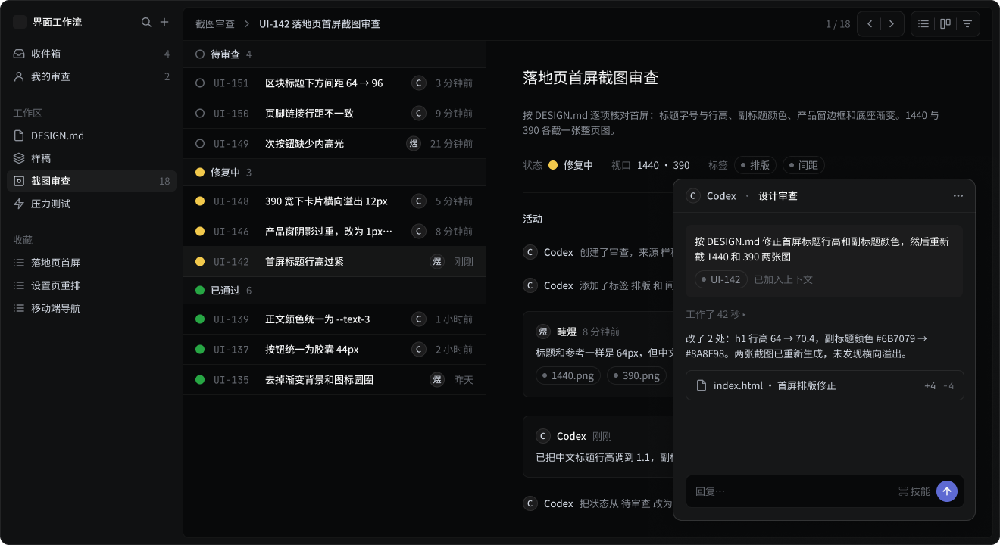
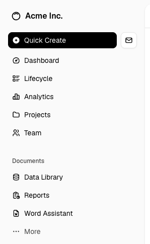
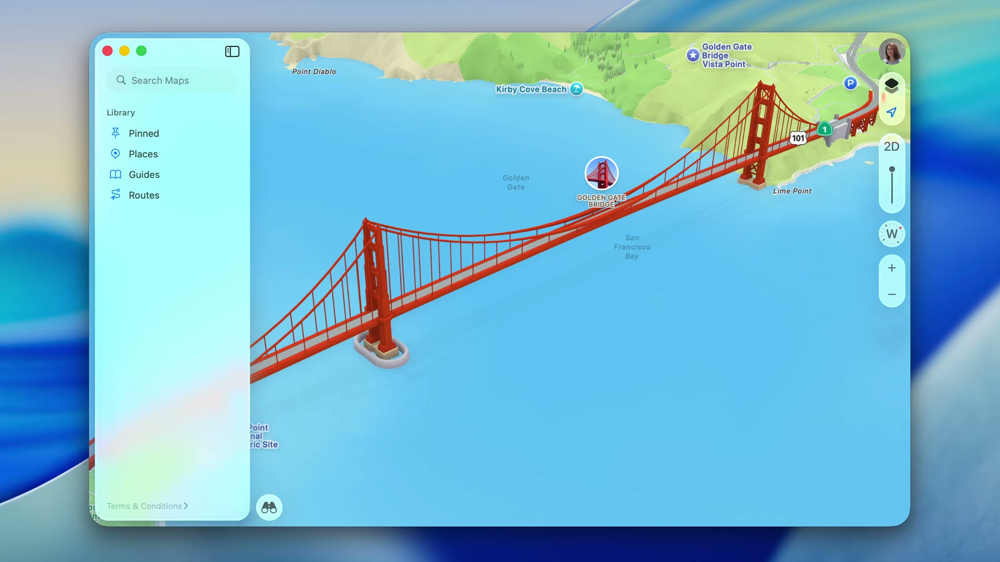
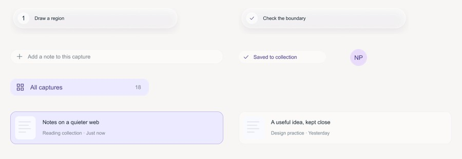

# 想画哪一块, 就找哪一块

先说出眼前的问题, 比如「我想让人看出选中了哪一行」, 再打开对应图片, 先看那一行, 再看它的上下两行

## 从这五处开始

| 想看什么 | 先看原件 | 再看我们怎么用 |
|---|---|---|
|  **Linear** · 从一排问题里选一个, 看完详情再做决定 | [基准原图](../foundations/linear-source.png) · [原 Figma](https://www.figma.com/design/cytw6jxvr7NDe0K406hGME?node-id=7-29) · [Linear 官方待审队列](https://linear.app/docs/triage) | [Quarry 元设计图](../evidence/linear.png) · [可编辑稿](https://www.figma.com/design/scYOkdhE2byoPHW4Gk1aDL/Untitled?node-id=11-7202) |
|  **shadcn/ui** · 侧栏的一行有多高, 图标与字隔多远 | [官网侧栏截图](originals/shadcn-sidebar.png) · [能点开的官方示例](https://ui.shadcn.com/view/new-york-v4/dashboard-01) | [Quarry 应用图](shadcn-ui.png) · [可编辑稿](https://www.figma.com/design/scYOkdhE2byoPHW4Gk1aDL/Untitled?node-id=47-20650) · [原尺寸组件](https://www.figma.com/design/scYOkdhE2byoPHW4Gk1aDL/Untitled?node-id=47-20892) |
|  **Untitled UI** · 两个按钮放一起, 怎么看出哪个是主要动作 | [官网按钮截图](originals/untitled-buttons.png) · [官方按钮](https://www.untitledui.com/react/components/buttons) · [官方输入框](https://www.untitledui.com/react/components/inputs) | [Quarry 应用图](untitled-ui.png) · [可编辑稿](https://www.figma.com/design/scYOkdhE2byoPHW4Gk1aDL/Untitled?node-id=50-21410) · [原尺寸组件](https://www.figma.com/design/scYOkdhE2byoPHW4Gk1aDL/Untitled?node-id=50-22310) |
|  **Apple Liquid Glass** · 地图的颜色在哪里透出来, 侧栏上的字如何看清 | [Apple 地图侧栏截帧](originals/apple-maps.jpg) · [官方演示 05:22](https://developer.apple.com/videos/play/wwdc2025/310/?time=322) · [Mac 设计素材](https://developer.apple.com/design/resources/#macos) | [Quarry 应用图](apple-liquid-glass.png) · [材质和原尺寸组件](https://www.figma.com/design/scYOkdhE2byoPHW4Gk1aDL/Untitled?node-id=52-24248) |
|  **灵感 Still** · 看带数字圆片的步骤按钮、输入框、选中行和两行记录 | [用户选中的组件拼图](still-components.jpg) · [原组件](https://www.figma.com/design/AnEre9JbzJYfQdhaOGtJqW/?node-id=16-19446) · [窗口表面](https://www.figma.com/design/AnEre9JbzJYfQdhaOGtJqW/?node-id=15-18322) | [同一组组件做出的五个方案](../cases/index.md) |

在 Still 这组里, 选中行只借窄行的淡紫, 步骤按钮只借白色圆片与细边, 铺满窗口的紫色和无描边的浅紫长按钮曾被退回

原图用来查出处, Quarry 图用来看它在调查任务里怎样使用, 例如想知道 Mac 软件怎样用玻璃侧栏, 除了看 Apple 地图, 还可以看另一位作者发布的真实窗口 [Things for Mac 3.22](https://culturedcode.com/things/blog/2025/09/things-for-os-26/)

## 还缺一张图时怎么找

1. **把动作写进搜索词**, 找输入框填错后的样子, 搜 `site:untitledui.com/react/components inputs invalid`, 找 Mac 顶栏, 搜 `site:developer.apple.com/videos AppKit toolbar`
2. **不知道产品名, 就从带图的用例找**, 在 X 搜 `"issue triage" filter:media`, 或在界面图库搜 `logs expanded`, 看到合适的局部就记下产品名, 去作者的演示或更新日志找原图, 只有点赞数、没有画面的帖子可以跳过
3. **留下能看懂来龙去脉的图**, 既看选中的一行, 也看旁边普通的一行, 记下作者、链接、点了什么、想借哪处, 模糊截图里读不出的间距或透明度写「待测」
4. **知道该怎么画, 就停下来试**, 如果已经知道部位、状态和采用哪一点, 用自己的文字做一个样件, 还看不清选中态, 就只补找选中态, 同一张图的转载只留原出处

**之前实际找过的两个例子**

- **量一行**, 打开 shadcn/ui 的 Dashboard 01, 当时用 1440 × 1000 的浅色桌面窗口量到侧栏行高 32 px, 图标 16 px, 图标到文字 8 px, 我们把这三个数用到任务侧栏里, 再放入自己的长任务名检查, 收入数字和图表留在原示例 [官方运行页](https://ui.shadcn.com/view/new-york-v4/dashboard-01) · [对应版本的源码](https://ui.shadcn.com/r/styles/new-york-v4/dashboard-01.json) · [本稿侧栏](shadcn-ui.png)
- **找展开后的样子**, 从 Mobbin 图库发现 Sentry 的日志表, 到 Sentry 自己的文档里看点开一行之后会出现什么, 我们让订单和重试字段紧跟被点开的记录, 在本稿把两者间距设成 0 px [图库条目](https://mobbin.com/explore/screens/607edc87-38b9-43d0-a58c-10d1a60485d9) · [Sentry 文档原图](https://github.com/getsentry/sentry-docs/blob/master/docs/product/logs/img/LogsExpanded.png) · [本稿的取值和出处](../cases/mobbin/case.json)
