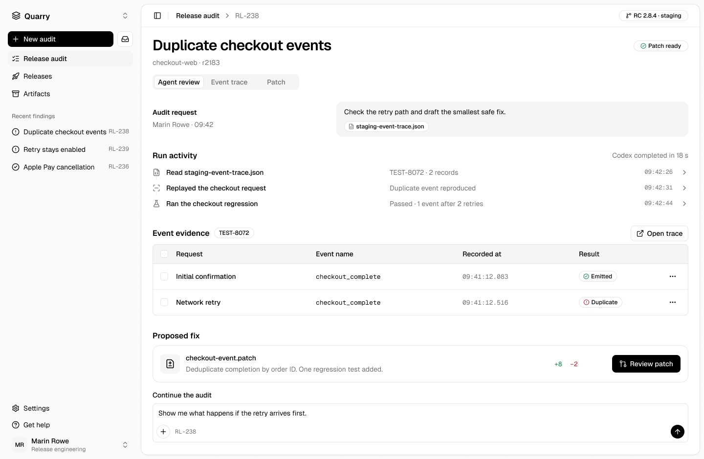
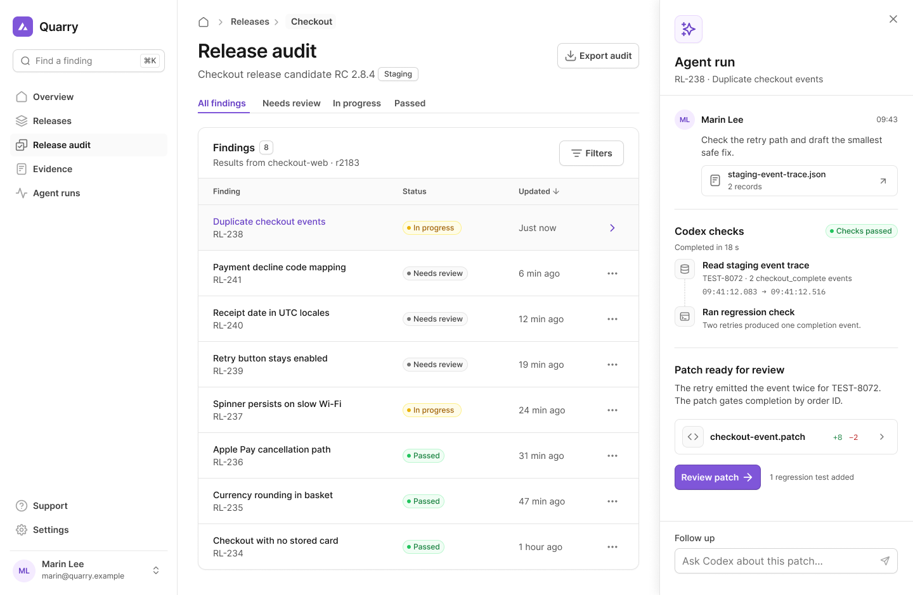

# 两份组件库首稿是怎样画出来的

两张图都是首次写入 Figma 后立刻导出的 1440 × 940 原稿, 左图打开了一个问题, 右图打开了一批问题并选中其中一个, 在修按钮、标签或分隔线之前, 两稿就已经有各自的阅读顺序和操作位置

| shadcn/ui · 查看一次调查 | Untitled UI · 从八个问题中审查一项 |
|---|---|
|  |  |

## 画第一稿前, 哪些事情已经定了

**先定调查要回答的问题**, 当时的要求是“多看看这两个组件库的真实组件的 UI”, “先定义出明确的各细节的规范”, 制作时另外决定沿用 Linear 稿已有的发布审查案例, 两位绘图者都读过那份稿的绘图源码, 订单 `TEST-8072` 有两次同名事件, 时间分别为 `09:41:12.083` 和 `09:41:12.516`, Agent 收到附件, 检查重试后提交 `checkout-event.patch` 供人审阅, 这些是设计案例里的样例数据, 足以决定界面必须让人对照什么、最后要按哪个按钮 [项目里的 Linear 基准稿](https://www.figma.com/design/scYOkdhE2byoPHW4Gk1aDL/Untitled?node-id=11-7202)

| 首稿的决定 | shadcn/ui | Untitled UI |
|---|---|---|
| 去哪里找整页骨架 | 选定 New York v4 的 Dashboard 01 浅色成品页, 保留左侧导航及内嵌白色工作区, 用调查活动和事件表替换营收指标与趋势图, 再采用 Tool 和 Prompt Input 两个 Agent 组件 [Dashboard 原页](https://ui.shadcn.com/view/new-york-v4/dashboard-01) · [Tool](https://ui.shadcn.com/docs/ai-elements/radix/tool) · [Prompt Input](https://ui.shadcn.com/docs/ai-elements/radix/prompt-input) | 从三个实物拼出一页, 用 Simple 侧栏定位工作区, 用 Team members 表格排列问题, 用 SlideoutMenu 显示所选项, 官方抽屉覆盖正文, 本稿取它的宽度和内部结构, 让详情与列表并排 [侧栏实图](library-process/untitled/sidebar.png) · [表格实图](library-process/untitled/table.png) · [抽屉源码](https://github.com/untitleduico/react/blob/bff7606f3ce705f0ba5984f383f11f865024e1f7/components/application/slideout-menus/slideout-menu.tsx) |
| 把空间留给哪项判断 | 用官网 288 px 侧栏, 正文可用宽度 1096 px, 依次放请求、3 条运行记录、2 行事件和补丁, 两个毫秒时间戳占同一列, 用户可以逐行比较, 审补丁的黑色按钮紧邻文件 | 用官网 280 px 侧栏, 右侧常驻 400 px 详情, 中间余下 760 px, Linear 案例中的 8 个问题排成一张表, 当前行提到第一行, 右栏只放这一项的请求、附件、检查、补丁和追问, 用户看详情时仍能看见整批问题 |
| 如何决定密度和主次 | 在浏览器读取菜单行 32 px、示例数据行 53 px, 首稿用 Geist 30 / 36 px 写具体问题, 用 Geist Mono 写时间戳, 审阅动作使用库里的黑底按钮 [测量记录](library-process/shadcn/measurements.md) | 对照官网中号表格的 72 px 数据行和 40 px 中号按钮, 首稿用 Inter 30 / 38 px 写发布审查标题, 20 / 30 px 写右栏 Agent 标题, 导出用白底, 审补丁用品牌紫底, 读者能分辨页面和当前详情的动作 [测量记录](library-process/untitled/measurements.md) |

同样两条事件记录, 左图给它们一张能横向比较的表, 右图把两次时间收在一次 Agent 检查里, 把空间给八个问题, 复用这次方法时, 先决定用户此刻要比较的对象, 再选能同时容纳这些对象的参考实物

看首次绘图时的文字与时间记录

以下是 2026-11-20 北京时间的制作记录, 附图取自首次导出回执

- 00:45, 用户要求先看两套库的真实控件并定规范, 随后的工作计划写明“沿用 Linear 稿的发布审查任务”
- 00:49, shadcn/ui 绘图者已查看官网侧栏、表格与输入实图, 当时写下“把运行记录、事件证据和补丁安排在同一个审查页内”, 00:51 写入第一版测量规格, 00:52 写入两栏绘图函数, 00:54 首次导出
- 00:51, Untitled UI 绘图者已读取侧栏、表格、主题、按钮和抽屉源码, 00:55 首次绘图函数注明 `SlideoutMenu adapted to keep the audit list in view`, 00:56 首次导出, 该轮 8 个参考及 90 条规则的规格文件在首次绘图函数之后、首次导出之前写入, 研究和绘图曾并行

## shadcn/ui: 沿着一条记录读到补丁

研究时打开 New York v4 的 Dashboard 01, 在 1440 × 1000 的浅色桌面视口测量, 再把窗口切到 740 × 820 观察窄窗导航, 在运行页面读控件的宽高、内距和字形, 对照同一版本的组件定义 [官方示例](https://ui.shadcn.com/view/new-york-v4/dashboard-01) · [组件源码清单](https://ui.shadcn.com/r/styles/new-york-v4/dashboard-01.json)

| 在官网做什么 | 量到什么 | Quarry 稿怎样取用 |
|---|---|---|
| 展开侧栏, 选一个菜单项 | 侧栏 288 px, 菜单行高 32 px, 图标 16 px, 图文间距 8 px | 保留常驻导航, 用同一组尺寸画当前的 Release audit [侧栏实图](originals/shadcn-sidebar.png) |
| 向下滚到 Outline 表格 | 表头高 40 px, 第一行高 53 px, 状态标签高 22 px | 把首次发送和网络重试放在相邻两行, 两次时间对在同一列, 只画一次行分隔 [表格实图](library-process/shadcn/03-table.png) |
| 点 Cover page 打开详情, 用键盘聚焦 Header | 右侧抽屉宽 384 px, 输入高 36 px, 外侧焦点环宽 3 px | 当前桌面稿把事件表放在正文, 用 36 px 高的黑色按钮审补丁, 为可继续输入多行内容的追问框另取 80 px 高 [桌面抽屉](library-process/shadcn/04-drawer.png) · [输入焦点](library-process/shadcn/05-input.png) |
| 缩到 740 px 再点侧栏开关 | 宽 288 px 的导航从左侧展开, 其余页面出现遮罩 | 这份截图用来记录窄窗状态, 已交的 1440 px 稿展示展开的常驻导航 [窄窗截图](library-process/shadcn/06-sheet.png) |

在 1440 × 2193 的规范板上, 可以分别查看指标、按钮和正文的三种字重、6 项独立尺寸、3 个原尺寸样件和 3 处官网截图, 到实际稿选中任一事件行, 请求、事件名、时间戳在行内的起点依次是 48、334、634 px, 上下两行使用同一组坐标 [原尺寸事件行](https://www.figma.com/design/scYOkdhE2byoPHW4Gk1aDL/Untitled?node-id=50-23155) · [可编辑成稿](https://www.figma.com/design/scYOkdhE2byoPHW4Gk1aDL/Untitled?node-id=47-20650)

## Untitled UI: 让人分得清状态与动作

研究从默认浅色 React 组件开始, 用 1440 px 视口读取官网预览, 再核对固定版本的源码, 例如控件的高和宽可以从页面量出, 焦点、悬停与禁用则分别查看对应状态和实现 [按钮预览](https://www.untitledui.com/react/components/buttons#button-example) · [本次核对的源码版本](https://github.com/untitleduico/react/tree/bff7606f3ce705f0ba5984f383f11f865024e1f7)

| 在官网对照什么 | 量到什么 | Quarry 稿怎样取用 |
|---|---|---|
| 在同一行看主按钮和次按钮 | 中号高 40 px, 圆角 8 px, 图标 20 px, 图文相距 4 px, 按钮文字 14 / 20 px | 审补丁使用紫底, 导出审查使用白底和 1 px 内边线, 两个动作都按图标与标签整体居中 [官网按钮](originals/untitled-buttons.png) · [本稿按钮样件](https://www.figma.com/design/scYOkdhE2byoPHW4Gk1aDL/Untitled?node-id=50-22771) |
| 比较普通输入和输错后的输入 | 中号高 40 px, 标签到输入框、输入框到说明各留 6 px, 错误态有边线、尾图标和独立提示 | 右侧追问用 40 px, 左侧搜索用 36 px, 本稿显示正常状态, 错误样例保留给表单有错误时使用 [正常](library-process/untitled/input-default.png) · [错误](library-process/untitled/input-invalid.png) |
| 看默认表格内一条记录和相邻记录 | 中号表头高 44 px, 数据行高 72 px, 记录上下内距各 16 px | 在一张表里列出八个问题, 固定问题、状态、更新时间的列位置, 右侧 400 px 栏显示所选项, 两边可同时阅读 [官网表格](library-process/untitled/table.png) |
| 看带点的状态标签 | 小号高 22 px, 圆点直径 6 px, 位于 8 px 图标框内 | 表内的状态用白底、灰边、圆点和文字, 右侧的检查通过另用浅绿标签, 审阅按钮仍等人操作 [状态实图](library-process/untitled/badges.png) |

1440 × 1970 的规范板还保留 Inter 输入文字、按钮和状态标签的字号与行高, 三个原尺寸样件分别是审补丁、检查通过和搜索, 在 Figma 里可以从成稿中的实例找到规范板上的主组件 [状态样件](https://www.figma.com/design/scYOkdhE2byoPHW4Gk1aDL/Untitled?node-id=50-22779) · [搜索样件](https://www.figma.com/design/scYOkdhE2byoPHW4Gk1aDL/Untitled?node-id=50-22785) · [可编辑成稿](https://www.figma.com/design/scYOkdhE2byoPHW4Gk1aDL/Untitled?node-id=50-21410)

首稿之后的局部修订与完整规范板

shadcn/ui 对照官网把标签组从 32 px 调到 36 px, Untitled UI 表格中的有色底标签改为白底灰边和彩色圆点, 原尺寸样件随后从设计稿提取, 其中 2 个 shadcn/ui 控件和 3 个 Untitled UI 控件关联到主组件, 脚本确认转换前后的整稿和规范板导出一致 [早期表格](library-process/untitled/table-first-draft.jpg) · [shadcn/ui 完整规范板](library-process/shadcn/board.png) · [Untitled UI 完整规范板](library-process/untitled/board.png) · [五个实例](library-process/checks.json)

[shadcn/ui 终稿](shadcn-ui.png) · [Figma 规范板](https://www.figma.com/design/scYOkdhE2byoPHW4Gk1aDL/Untitled?node-id=47-20892) · [Untitled UI 终稿](untitled-ui.png) · [Figma 规范板](https://www.figma.com/design/scYOkdhE2byoPHW4Gk1aDL/Untitled?node-id=50-22310)

## 换成自己的稿, 怎么查

1. 在对应主题、视口和控件状态下打开官网, 给一条普通行和一条选中行各截一张, 同时保留相邻背景, 写明从哪一个状态进入
2. 单独记行高、可见图标大小、字与图的间距, 说明哪些数来自官网, 哪些尺寸为本任务另定, 再把最长的真实文字放入样件, 按 1× 查看
3. 在成稿中选中按钮里的图标和文字, 把整组包在一个矩形内, 量它到按钮两侧的距离, 再从一行读到下一行, 逐列核对同一字段是否对齐
4. 从成稿导出原尺寸 PNG 并对照规范样件, 这两稿交付时分别核过 30 和 46 项组件检查, 每稿核过 8 处图标位置, 两稿的审补丁按钮整组水平与垂直中心偏差都为 0 px, 图文间距分别为 6 px 与 4 px, 这些读数对应这两张静态稿 [回读记录与画板摘要](library-process/checks.json)

[返回参考库](README.md)
