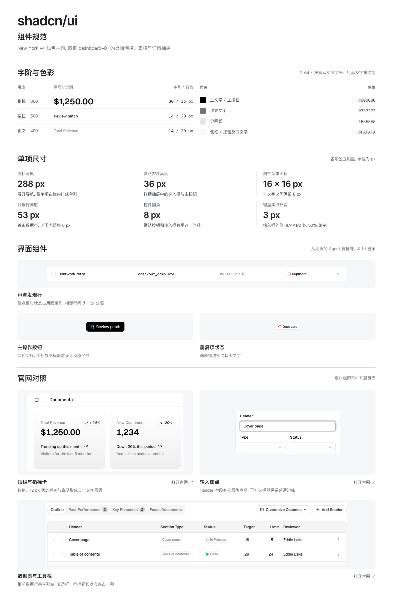
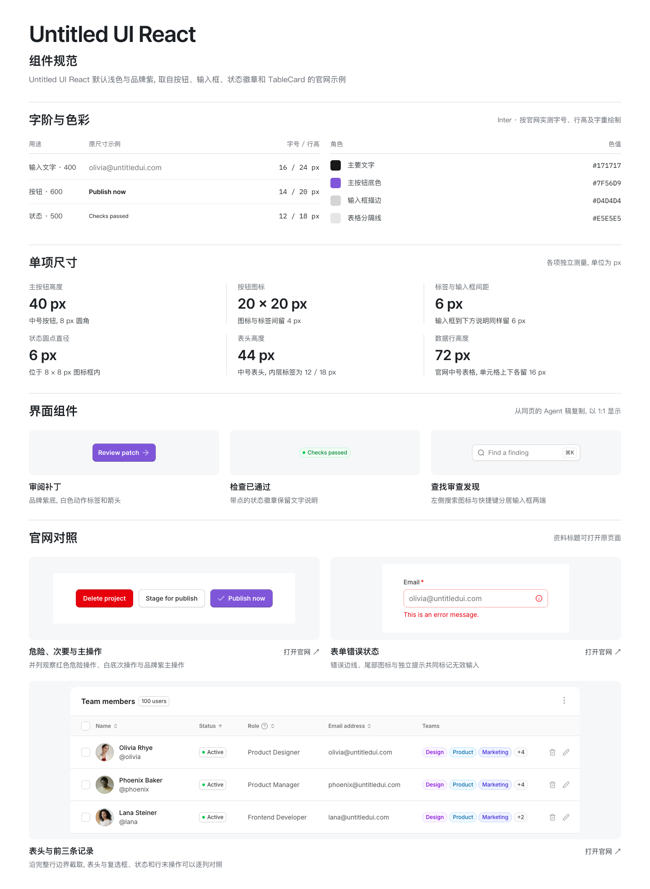

# 组件库研究: 同一张审查页, 细节怎样定下来

两份稿都让人检查重复的结算事件并审阅补丁, shadcn/ui 把证据放进一张紧凑的表, Untitled UI 列出八个待查问题, 在右侧保留当前问题的调查经过, 想看制作依据, 可以直接点开下面两张完整规范板

| shadcn/ui | Untitled UI |
|---|---|
|  |  |
| [看成稿](shadcn-ui.png) · [在 Figma 查看规范](https://www.figma.com/design/scYOkdhE2byoPHW4Gk1aDL/Untitled?node-id=47-20892) · [读测量笔记和 6 张官网截图](library-process/shadcn/measurements.md) | [看成稿](untitled-ui.png) · [在 Figma 查看规范](https://www.figma.com/design/scYOkdhE2byoPHW4Gk1aDL/Untitled?node-id=50-22310) · [读测量笔记和 8 张官网截图](library-process/untitled/measurements.md) |

## shadcn/ui: 沿着一条记录读到补丁

研究时打开 New York v4 的 Dashboard 01, 在 1440 × 1000 的浅色桌面视口测量, 再把窗口切到 740 × 820 观察窄窗导航, 在运行页面读控件的宽高、内距和字形, 对照同一版本的组件定义 [官方示例](https://ui.shadcn.com/view/new-york-v4/dashboard-01) · [组件源码清单](https://ui.shadcn.com/r/styles/new-york-v4/dashboard-01.json)

| 在官网做什么 | 量到什么 | Quarry 稿怎样取用 |
|---|---|---|
| 展开侧栏, 选一个菜单项 | 侧栏 288 px, 菜单行高 32 px, 图标 16 px, 图文间距 8 px | 保留常驻导航, 用同一组尺寸画当前的 Release audit [侧栏实图](originals/shadcn-sidebar.png) |
| 向下滚到 Outline 表格 | 表头高 40 px, 第一行高 53 px, 状态标签高 22 px | 把首次发送和网络重试放在相邻两行, 两次时间对在同一列, 只画一次行分隔 [表格实图](library-process/shadcn/03-table.png) |
| 点 Cover page 打开详情, 用键盘聚焦 Header | 右侧抽屉宽 384 px, 输入高 36 px, 外侧焦点环宽 3 px | 当前桌面稿把事件表放在正文, 用 36 px 高的黑色按钮审补丁, 为可继续输入多行内容的追问框另取 80 px 高 [桌面抽屉](library-process/shadcn/04-drawer.png) · [输入焦点](library-process/shadcn/05-input.png) |
| 缩到 740 px 再点侧栏开关 | 宽 288 px 的导航从左侧展开, 其余页面出现遮罩 | 这份截图用来记录窄窗状态, 已交的 1440 px 稿展示展开的常驻导航 [窄窗截图](library-process/shadcn/06-sheet.png) |

在 1440 × 2193 的规范板上, 可以分别查看指标、按钮和正文的三种字重、6 项独立尺寸、3 个原尺寸样件和 3 处官网截图, 到实际稿选中任一事件行, 请求、事件名、时间戳在行内的起点依次是 48、334、634 px, 上下两行使用同一组坐标 [原尺寸事件行](https://www.figma.com/design/scYOkdhE2byoPHW4Gk1aDL/Untitled?node-id=50-23155) · [可编辑成稿](https://www.figma.com/design/scYOkdhE2byoPHW4Gk1aDL/Untitled?node-id=47-20650)

## Untitled UI: 让人分得清状态与动作

研究从默认浅色 React 组件开始, 用 1440 px 视口读取官网预览, 再核对固定版本的源码, 例如控件的高和宽可以从页面量出, 焦点、悬停与禁用则分别查看对应状态和实现 [按钮预览](https://www.untitledui.com/react/components/buttons#button-example) · [本次核对的源码版本](https://github.com/untitleduico/react/tree/bff7606f3ce705f0ba5984f383f11f865024e1f7)

| 在官网对照什么 | 量到什么 | Quarry 稿怎样取用 |
|---|---|---|
| 在同一行看主按钮和次按钮 | 中号高 40 px, 圆角 8 px, 图标 20 px, 图文相距 4 px, 按钮文字 14 / 20 px | 审补丁使用紫底, 导出审查使用白底和 1 px 内边线, 两个动作都按图标与标签整体居中 [官网按钮](originals/untitled-buttons.png) · [本稿按钮样件](https://www.figma.com/design/scYOkdhE2byoPHW4Gk1aDL/Untitled?node-id=50-22771) |
| 比较普通输入和输错后的输入 | 中号高 40 px, 标签到输入框、输入框到说明各留 6 px, 错误态有边线、尾图标和独立提示 | 右侧追问用 40 px, 左侧搜索用 36 px, 本稿显示正常状态, 错误样例保留给表单有错误时使用 [正常](library-process/untitled/input-default.png) · [错误](library-process/untitled/input-invalid.png) |
| 看默认表格内一条记录和相邻记录 | 中号表头高 44 px, 数据行高 72 px, 记录上下内距各 16 px | 在一张表里列出八个问题, 固定问题、状态、更新时间的列位置, 右侧 400 px 栏显示所选项, 两边可同时阅读 [官网表格](library-process/untitled/table.png) |
| 看带点的状态标签 | 小号高 22 px, 圆点直径 6 px, 位于 8 px 图标框内 | 表内的状态用白底、灰边、圆点和文字, 右侧的检查通过另用浅绿标签, 审阅按钮仍等人操作 [状态实图](library-process/untitled/badges.png) |

1440 × 1970 的规范板还保留 Inter 输入文字、按钮和状态标签的字号与行高, 三个原尺寸样件分别是审补丁、检查通过和搜索, 在 Figma 里可以从成稿中的实例找到规范板上的主组件 [状态样件](https://www.figma.com/design/scYOkdhE2byoPHW4Gk1aDL/Untitled?node-id=50-22779) · [搜索样件](https://www.figma.com/design/scYOkdhE2byoPHW4Gk1aDL/Untitled?node-id=50-22785) · [可编辑成稿](https://www.figma.com/design/scYOkdhE2byoPHW4Gk1aDL/Untitled?node-id=50-21410)

## 换成自己的稿, 怎么查

1. 在对应主题、视口和控件状态下打开官网, 给一条普通行和一条选中行各截一张, 同时保留相邻背景, 写明从哪一个状态进入
2. 单独记行高、可见图标大小、字与图的间距, 说明哪些数来自官网, 哪些尺寸为本任务另定, 再把最长的真实文字放入样件, 按 1× 查看
3. 在成稿中选中按钮里的图标和文字, 把整组包在一个矩形内, 量它到按钮两侧的距离, 再从一行读到下一行, 逐列核对同一字段是否对齐
4. 从成稿导出原尺寸 PNG 并对照规范样件, 这两稿交付时分别核过 30 和 46 项组件检查, 每稿核过 8 处图标位置, 两稿的审补丁按钮整组水平与垂直中心偏差都为 0 px, 图文间距分别为 6 px 与 4 px, 这些读数对应这两张静态稿 [回读记录与画板摘要](library-process/checks.json)

[返回参考库](README.md)
